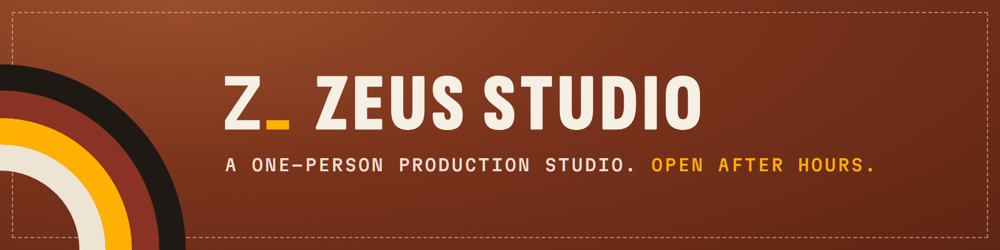

A one-person production studio. Apps, browser tools, templates and games, made off the clock.

## Worklings


**Claude Code, with an office around it.** Your words go to your own `claude`, unchanged, and a cozy low-poly 3D
office shows what it is doing: an inbox for its questions and permission prompts, budgets, its todo list as a task
board and its subagents as helpers. Open source, MIT.

- [The repository](https://github.com/zeusstudiodev/worklings)
- [The live demo](https://zeusstudiodev.github.io/worklings/), in your browser with nothing to install

In Claude Code:

```bash
claude plugin marketplace add zeusstudiodev/worklings
claude plugin install worklings@worklings
```

Then `/worklings:hub` opens the lobby.

---

More from the studio at [zeusstudio.dev](https://zeusstudio.dev).
